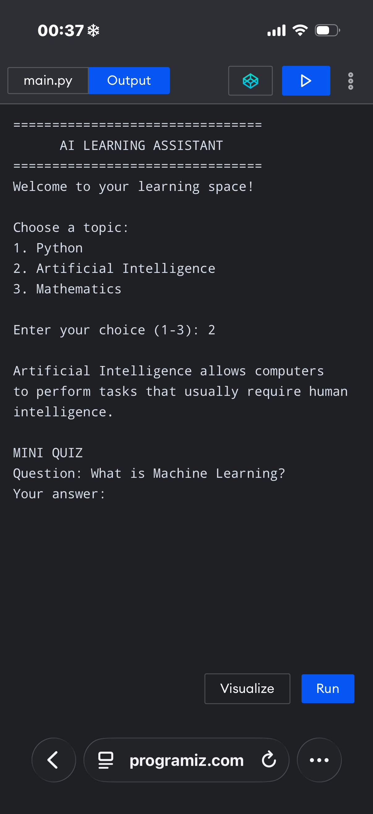

AI Learning Assistant

A Beginner Python Project | Computer Science & AI

About

AI Learning Assistant is an interactive educational program built using Python. It helps students explore learning topics and answer a basic quiz.

Features

## Features
- Interactive learning menu
- Python, Artificial Intelligence and Mathematics topics
- Topic explanations
- 5-question AI quiz
- Automatic answer checking
- Score tracking out of 5
- Percentage calculation

Technologies

* Python
* Conditional statements
* User input
* String methods

Motivation

I am interested in Computer Science and Artificial Intelligence. I started this project to improve my programming skills and explore how technology can make education more interactive and accessible.

Current Status

First working prototype. More features are under development.

Future Goals

* Add more quiz questions
* Introduce score tracking
* Save learning progress
* Explore genuine AI integration

Developer

Student | Aspiring Computer Science and AI learner

